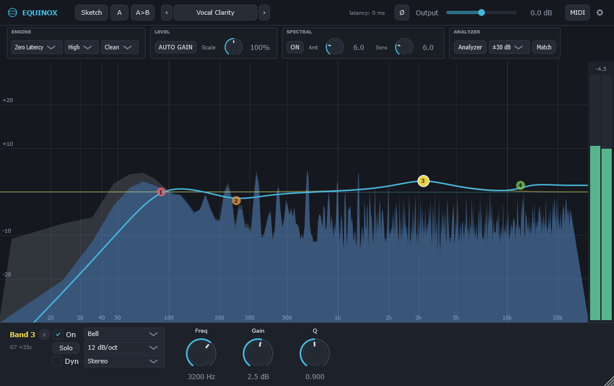
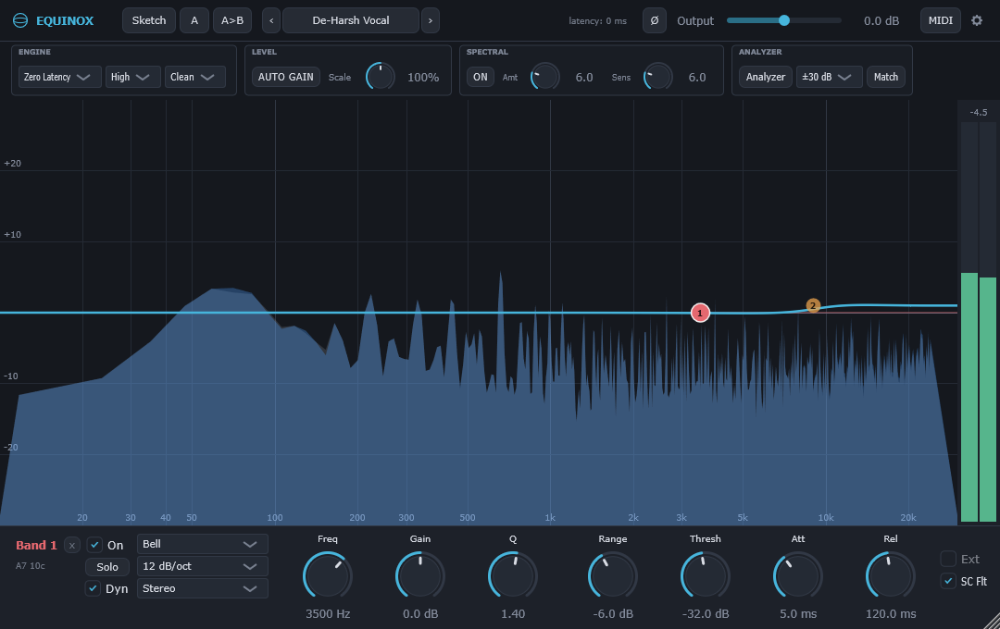
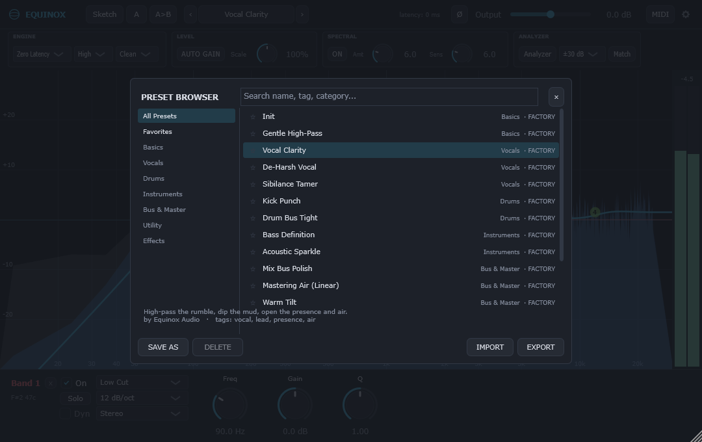

# Equinox

**A free, open-source 24-band parametric EQ for mixing and mastering.**

Equinox is a fast, visual EQ: you draw bands straight onto a live spectrum analyzer,
and each band can also work as a dynamic EQ. It runs in zero-latency, natural-phase or
linear-phase mode, and it can match the tone of a reference track. It is part of the
**Equinox Audio** family alongside [Meridian](https://github.com/JDMcE/Meridian)
(compressor), [Zenith](https://github.com/JDMcE/Zenith) (limiter) and
[Horizon](https://github.com/JDMcE/Horizon) (reverb).



## Features

- **24 bands** with 10 shapes: bell, low/high shelf, low/high cut (up to brickwall),
  notch, band-pass, tilt shelf, flat tilt and all-pass
- **Per-band channel routing**: Stereo, Left, Right, Mid or Side
- **Dynamic EQ on every band**: threshold, range, attack and release, with optional
  external sidechain triggering
- **Spectral dynamics**: automatically tames frequencies that poke out above the
  rest of the spectrum
- **Three phase modes**: Zero Latency, Natural Phase and Linear Phase (five quality levels)
- **EQ Match**: capture your track and a reference, and Equinox fits bands to the difference
- **EQ Sketch**: draw the curve you want and Equinox fits bands to it
- **Spectrum Grab**: drag a peak in the analyzer to drop a band right on it
- **Intelligent solo**: hear just the range one band is affecting
- **Character** (Clean / Gentle / Warm) analog-style saturation, **Auto Gain** and
  **Gain Scale**
- **Presets**, **A/B comparison**, **undo/redo** and **MIDI Learn**
- Mono and stereo, with an optional sidechain input
- Optional GPU (OpenGL) rendering and hover help hints

<table>
<tr>
<td></td>
<td></td>
</tr>
<tr>
<td align="center"><sub>Dynamic EQ on any band</sub></td>
<td align="center"><sub>Preset browser</sub></td>
</tr>
</table>

## Download & install

Download the latest build from the
[Releases page](https://github.com/JDMcE/Equinox/releases).

**Windows (64-bit VST3):**

1. Unzip the download.
2. Copy `Equinox.vst3` into `C:\Program Files\Common Files\VST3\`.
3. Restart your DAW or rescan plugins. Equinox appears under **Equinox Audio**.

Prebuilt releases are Windows-only for now. On other platforms you can build from
source (see [For developers](#for-developers)).

## Using Equinox

### On the EQ display

| Action | What it does |
|---|---|
| **Double-click** empty space | Add a band |
| **Drag** a handle | Change frequency / gain |
| **Mouse wheel** over a handle | Change Q (width) |
| **Double-click** a handle | Type in freq/gain/Q (accepts `1.2k` and note names like `A4`) |
| **Alt + hold** a handle (or hold **Solo**) | Intelligent solo: hear only that band's range |
| **Right-click** a handle | Shape, slope, channel routing, copy/paste band, snap to note, reset gain, delete |
| **Right-click** empty space | Paste band, copy/paste preset (works across instances), analyzer options |
| **Drag** the grab dot on a spectrum peak | Create a band right on the peak (Spectrum Grab) |

### Header buttons

- **Sketch**: draw the curve you want; bands are fitted when you release the mouse
- **Match**: EQ Match. Capture the input and a reference (from the sidechain, or a
  spectrum pasted from another Equinox instance), then fit bands to the difference
- **A/B** and **A>B**: compare two settings, or copy A onto B
- **±3 / 6 / 12 / 30 dB**: display range (narrow for mastering, wide for mixing)
- **MIDI**: MIDI Learn. Map hardware CCs to Output Gain, Gain Scale, or the
  freq/gain/Q of the selected band
- **GPU**: render the UI with OpenGL. **Hints**: show hover help

### Keyboard shortcuts

| Keys | Action |
|---|---|
| `Ctrl+Z` | Undo |
| `Ctrl+Shift+Z` / `Ctrl+Y` | Redo |
| `P` | Open / close the preset browser |
| `[` / `]` | Previous / next preset |
| `Esc` | Close the preset browser |

### Presets

Factory presets are built in. User presets are plain `.eqnx` files in
`Documents\Equinox\Presets`, so they are easy to back up, sync or share.

## Feedback

Found a bug or have an idea? Please
[open an issue](https://github.com/JDMcE/Equinox/issues).

---

## For developers

### Building

Requirements: CMake 3.22+ and a C++20 compiler (developed with Visual Studio 2022).

Equinox shares code with the rest of the family through
[jdm_shared](https://github.com/JDMcE/jdm_shared), which must be checked out next to
this repository:

```
some-folder/
  Equinox/
  jdm_shared/
```

```
git clone https://github.com/JDMcE/Equinox.git
git clone https://github.com/JDMcE/jdm_shared.git
cd Equinox
git clone --depth 1 --branch 8.0.14 https://github.com/juce-framework/JUCE.git libs/JUCE
git clone --recurse-submodules https://github.com/free-audio/clap-juce-extensions.git libs/clap-juce-extensions
cmake -S . -B build
cmake --build build --config Release --target eeQ_VST3 eeQ_Standalone eeQ_CLAP
```

Outputs:

- VST3: `build/eeQ_artefacts/Release/VST3/Equinox.vst3`
- CLAP: `build/eeQ_artefacts/Release/CLAP/Equinox.clap`
- Standalone app: `build/eeQ_artefacts/Release/Standalone/Equinox.exe`

Code targets and namespaces use the internal name `eeq`.

### Tests

The `eeq_tests` target builds an offline DSP verification harness. Run the built
executable; it exits non-zero on failure.

### Project layout

```
src/
  Parameters.h          parameter IDs, ranges, APVTS layout (24 bands + master)
  PluginProcessor.*     audio processing: band cascade, smoothing, metering, analyzer feeds
  PluginEditor.*        top-level UI: header bar, display, band panel, meter
  dsp/
    FilterCoeffs.h      RBJ biquads, Butterworth cut cascades, response evaluation
    EqBand.h            per-band biquad state + Stereo/L/R/M/S block processing
    LinearPhaseEngine.h FFT overlap-add linear-phase engine (2x2 L/R kernel matrix)
    SpectralDynamics.h  per-bin spectral dynamics
    AnalyzerFifo.h      lock-free audio->GUI FIFO for the spectrum analyzer
  presets/              product config for the shared preset manager
  ui/
    EqDisplay.*         analyzer + EQ curve + draggable band handles
    BandPanel.*         selected-band controls
    LevelMeter.h        stereo peak meter with peak-hold readout
test/
  DspTests.cpp          offline DSP verification harness
```

## License

Equinox is free software, released under the GNU Affero General Public License v3.0;
see [LICENSE](LICENSE). It is built on [JUCE](https://juce.com), used under JUCE's
AGPLv3 open-source licence.
